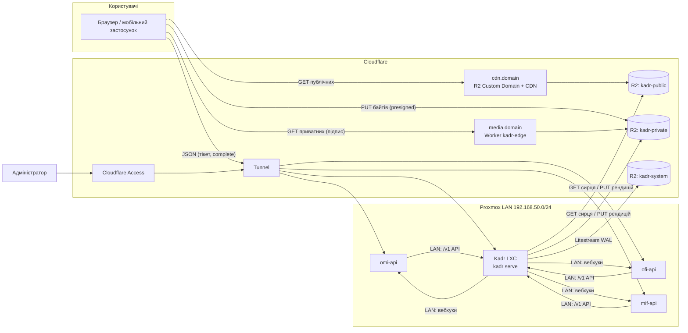
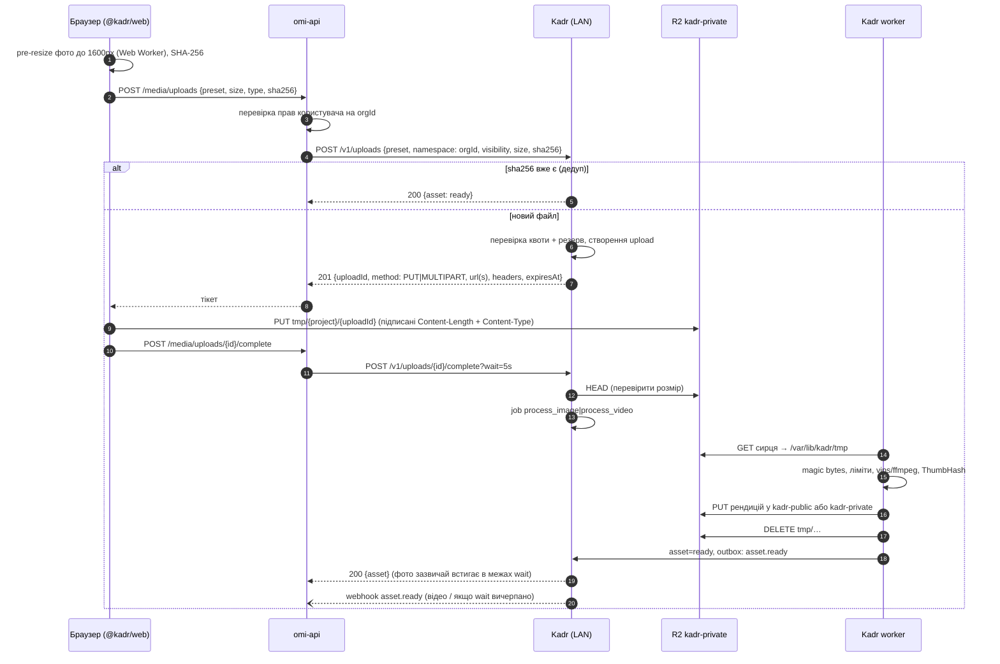
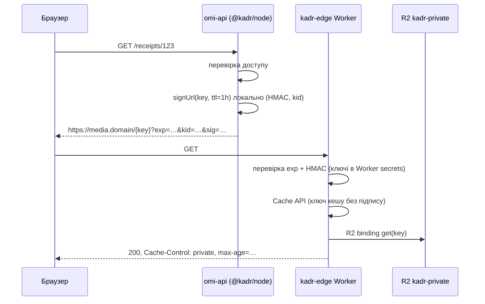

# Архітектура Kadr

## 1. Принципи

1. **Kadr не стоїть на шляху читання.** Перегляди йдуть із Cloudflare (R2 Custom Domain для публічних файлів, edge Worker для приватних). Kadr бере участь лише у записі.
2. **Медіабайти не проходять через тунель і API проєктів.** Браузер вантажить прямо в R2; Kadr забирає файл із R2 (egress $0) по своєму каналу.
3. **Kadr не виставлений в інтернет.** Публічний API слухає лише LAN Proxmox. Адмінка доступна через Cloudflare Access (лише JSON і статика).
4. **Мінімум процесів у простої.** Один Go-бінарник; `vips`, `ffmpeg`, `rclone` запускаються як короткоживучі процеси під задачу.
5. **Без стану поза одним файлом.** Постійні дані — у R2; метадані й черга — у `kadr.db` (SQLite WAL), який безперервно реплікується в R2.
6. **Незмінні рендиції.** Кожен згенерований файл незмінний (`Cache-Control: immutable`). Зміна пресету створює нову версію з новим URL, а не перезаписує стару.
7. **Шари замінні без переписування.** Інтерфейси `Store`, `Queue`, `ImageEngine`, `VideoEngine`, `StorageDriver` дозволяють перейти на Postgres, віддалених воркерів, GPU-вузли або іншого S3-провайдера.

## 2. Контекст системи



**Трафік через тунель:** лише JSON проєктів і адмінка. **Трафік Proxmox ↔ R2:** завантаження сирця на обробку + вивантаження стиснених рендицій (зазвичай у 20–100 разів менше за сирець).

## 3. Компоненти всередині бінарника


| Модуль | Відповідальність | Ключові рішення |
|---|---|---|
| `api/public` | REST `/v1` для бекендів проєктів | OpenAPI 3.1, `Idempotency-Key`, курсорна пагінація, RFC 9457 помилки |
| `api/admin` | REST `/admin/api` для адмінки | Окремий порт, сесії в cookie, CSRF, TOTP |
| `auth` | Ключі `kd_live_…`/`kd_test_…`, scopes | Зберігається тільки SHA-256(ключ + pepper), префікс для пошуку |
| `pipeline` | Життєвий цикл upload → asset → renditions | Явна машина станів, події в outbox у тій самій транзакції |
| `queue` | Задачі з пріоритетами, ретраями, lease | `UPDATE … RETURNING`, visibility timeout, DLQ |
| `engine/image` | Декодування, ресайз, різкість, бюджетне кодування | libvips CLI, бінарний пошук якості, ThumbHash |
| `engine/video` | Перевірка, транскодування, постер | ffprobe-валідація, CRF+VBV, автодетект VAAPI |
| `storage` | Put/Get/Copy/Delete/Presign/Multipart | aws-sdk-go-v2, драйвер на профіль сховища (платформний або BYOS) |
| `delivery` | Підписані URL для приватних файлів | HMAC-SHA256 з `kid`, ротація ключів, ключі синхронізуються в Worker |
| `importer` | URL-імпорт, хмарні диски | Перевірка IP після DNS-резолву, ліміти; rclone як разовий процес |
| `webhook` | Доставка подій проєктам | Transactional outbox, специфікація Standard Webhooks, експоненційні ретраї |
| `observability` | Логи, метрики, health | slog JSON → journald, VictoriaMetrics/metrics, `/healthz`, `/readyz` |

## 4. Доменна модель

```
Project (omi-prod, ofi-prod, mif-prod, omi-staging…)
 ├── ApiKey[]            scopes: uploads:write, assets:read, assets:delete, urls:sign
 ├── SigningKey[]        kid + secret для приватних URL (ротація)
 ├── StorageProfile      платформний R2 або власний S3/R2 клієнта (BYOS)
 ├── Preset[] → PresetVersion[]   незмінні версії параметрів обробки
 ├── WebhookEndpoint[]
 └── Namespace[]         непрозорий ID від проєкту (orgId / householdId / userId), квоти
      └── Asset          логічний файл: visibility, metadata, status
           └── Blob      фізичний результат обробки (дедуплікація за sha256 + preset version)
                └── Rendition[]   avif/webp/mp4/poster: key, bytes, width, height
```

**Asset ≠ Blob.** Один і той самий файл, завантажений двічі в межах `(project, visibility, preset_version)`, дає два Asset і один Blob (refcount). Видалення Asset зменшує refcount; Blob і його обʼєкти в R2 видаляє GC, коли refcount = 0.

Повна схема: [DATA_MODEL.md](DATA_MODEL.md).

## 5. Потоки

### 5.1 Завантаження (фото або відео)



**Стійкість:**
- Якщо клієнт не викликав `complete`, sweeper робить `HEAD` для прострочених upload-ів: є обʼєкт — запускає обробку, немає — `upload.expired` і знімає резерв квоти.
- Lifecycle-правила R2: `tmp/` видаляється через 1 день, незавершені multipart скасовуються через 1 день.
- Повторний `complete` ідемпотентний; задачі мають `dedupe_key`.

### 5.2 Публічна видача

`https://cdn.<domain>/{project}/{blobId}/{rendition}.{ext}` — R2 Custom Domain, кеш Cloudflare, `immutable`. SDK рендерить `<picture>` з AVIF і WebP, тож Worker на публічному шляху не потрібен (жодних витрат на виклики Worker).

### 5.3 Приватна видача



Підпис генерується **локально в бекенді проєкту** через SDK — без мережевого запиту до Kadr на кожне посилання. Kadr лише керує ключами (створення, ротація, публікація в Worker через Cloudflare API).

### 5.4 Зміна видимості (private → public)

`PATCH /v1/assets/{id} {visibility: "public"}` → для кожної рендиції `CopyObject` між бакетами всередині R2 (без завантаження на Proxmox) → новий Blob → оновлення URL → `asset.updated`. Старий приватний обʼєкт видаляє GC.

### 5.5 Імпорт

- **За URL:** резолв DNS → блок приватних/loopback/link-local/metadata-діапазонів → зʼєднання саме на перевірений IP → ліміти розміру й часу → далі той самий пайплайн.
- **З хмарних дисків:** OAuth-підключення зберігається зашифрованим; під задачу генерується тимчасовий конфіг rclone (0600) → `rclone copyto` у tmp → пайплайн → конфіг видаляється.

## 6. Черга задач


- Захоплення задачі — одна атомарна інструкція `UPDATE jobs … WHERE id = (SELECT … ORDER BY priority, run_at LIMIT 1) RETURNING *`.
- Окремі пули й ліміти конкурентності для кожного `kind`: `image` = max(1, NumCPU/2), `video` = 1, `import` = 1, `webhook` = 4.
- Heartbeat продовжує lease довгих задач (відео); при graceful shutdown незавершені задачі повертаються в чергу.
- Ізоляція CPU: дочірні процеси `vips`/`ffmpeg` запускаються з `nice 10` + `ionice -c3`; systemd `CPUWeight`/`MemoryMax` на весь сервіс.

## 7. Сховища

| Бакет | Доступ | Вміст | Lifecycle |
|---|---|---|---|
| `kadr-public` | Custom Domain `cdn.<domain>` | Публічні рендиції `{project}/{blobId}/…` | — |
| `kadr-private` | Закритий; читання тільки через Worker binding або presigned GET | `tmp/…` сирці, приватні рендиції, оригінали (якщо пресет їх зберігає) | `tmp/` 1 день, abort multipart 1 день, `originals/` за політикою |
| `kadr-system` | Закритий, окремий токен | Репліка Litestream, експорти | Версії 30 днів |

Окремі R2 API-токени з мінімальними правами: `kadr-rw` (public+private), `kadr-backup` (лише system), Worker має тільки read binding на private.

**BYOS:** проєкт або його клієнт може підключити власний S3/R2/B2 (`storage_profiles`). Тоді Kadr обробляє файли, але зберігає результат у сховищі клієнта.

## 8. Модель розгортання і масштабування

| Стадія | Топологія | Коли |
|---|---|---|
| **S1 — зараз** | 1 LXC: `kadr serve` (API + адмінка + усі пули) | omi/ofi/mif, до ~сотень тисяч асетів/міс |
| **S2** | + N вузлів `kadr worker --control=http://kadr.lan` (GPU-хост, ще один LXC). Воркери беруть задачі через внутрішній lease API. Код пайплайну не змінюється. | Черга відео > 5 хв, потреба в NVENC/QSV |
| **S3 — SaaS** | Control plane на Postgres (той самий `Store`-інтерфейс, sqlc для обох діалектів), воркери в кількох регіонах, білінг з `usage_daily` | Зовнішні клієнти |

## 9. Відмови

| Що впало | Наслідок | Захист |
|---|---|---|
| Kadr LXC | Нові завантаження недоступні. **Перегляди працюють.** | systemd restart; проєкти показують «спробуйте пізніше»; відновлення з Litestream за хвилини |
| R2 | Перегляди й завантаження недоступні | SLA Cloudflare; BYOS-резерв для критичних проєктів (S3) |
| Диск LXC (втрата) | Втрата tmp і, можливо, кількох секунд метаданих | Litestream (RPO ≈ 1 с), сирці ще лежать у `tmp/` R2 протягом доби |
| Вебхук-ендпоінт проєкту | Події накопичуються | Ретраї до 24 год, повторна відправка з адмінки, `GET /v1/assets/{id}` як fallback |
| Біте/шкідливе медіа | Задача падає | Magic bytes, ліміт пікселів, ffprobe, таймаути, окремий tmp, без shell |

## 10. Бюджет ресурсів (S1)

| Стан | RAM | CPU |
|---|---|---|
| Простій (`kadr` + ОС LXC) | ~60–90 МБ | ~0 |
| Фото (кожна паралельна обробка) | +60–150 МБ | 1 ядро на 0.2–1 с |
| Відео 720p (libx264 slow, 2 потоки) | +300–600 МБ | 2 ядра, ~0.5–1× реального часу |
| Відео з VAAPI | +150–250 МБ | < 10% ядра, у 5–10× швидше |

Рекомендований LXC: **2–4 vCPU, 2 ГБ RAM + 512 МБ swap, 30 ГБ NVMe**. Деталі: [OPERATIONS.md](OPERATIONS.md).
