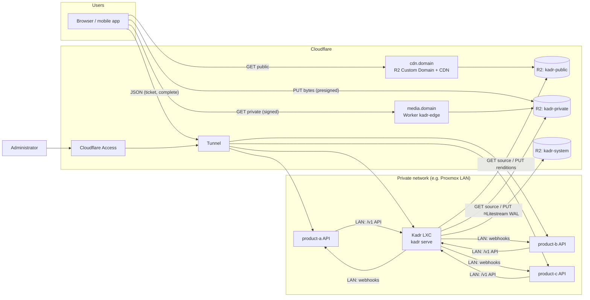
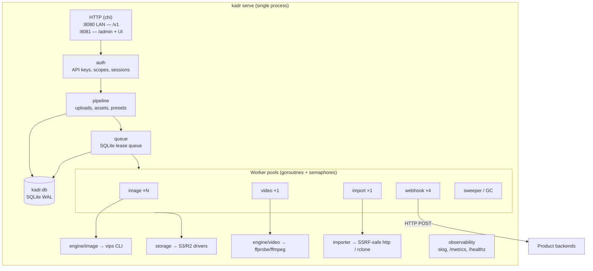
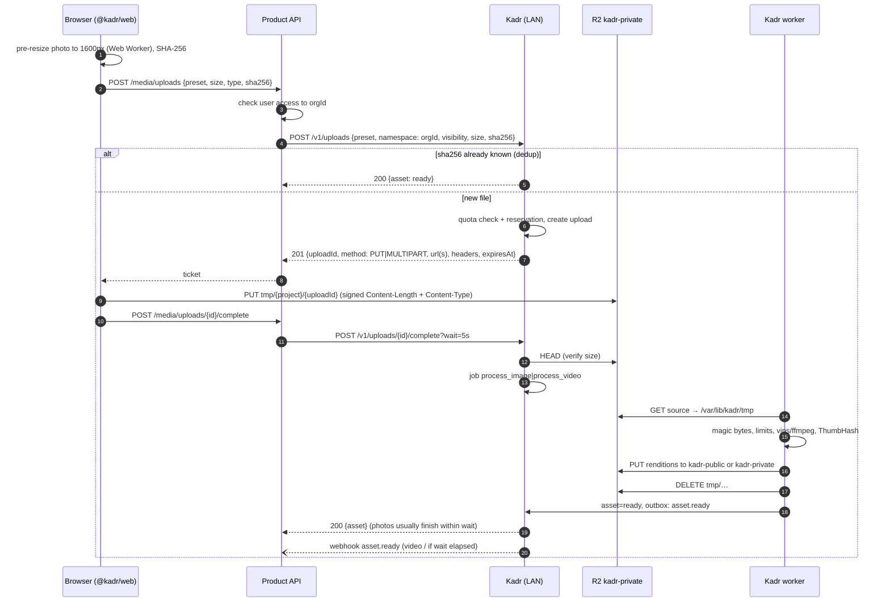
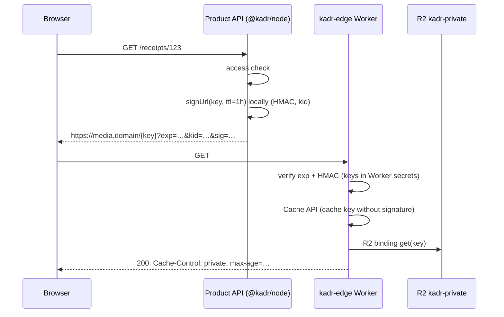
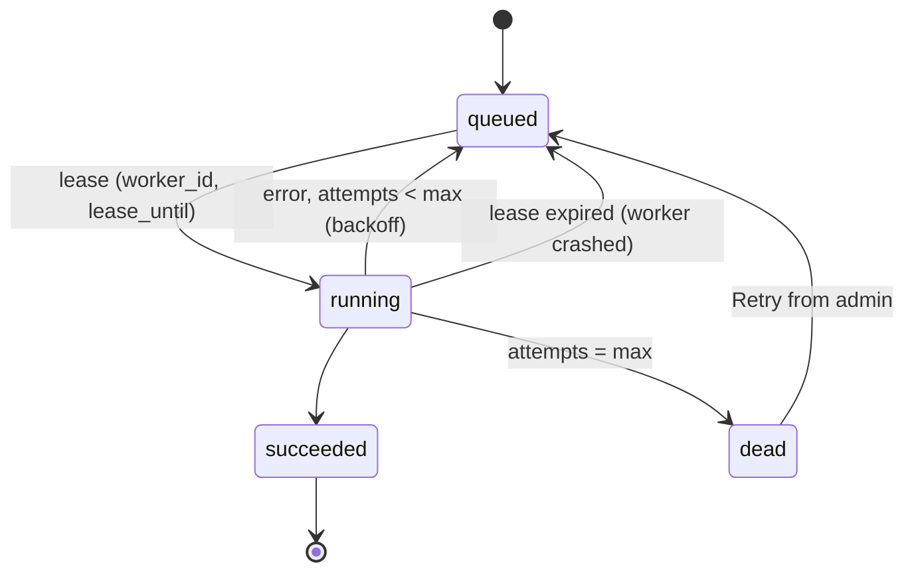

# Kadr Architecture

## 1. Principles

1. **Kadr is not on the read path.** Views are served by Cloudflare (R2 Custom Domain for public files, an edge Worker for private ones). Kadr only participates in writes.
2. **Media bytes never pass through the tunnel or product APIs.** The browser uploads directly to R2; Kadr pulls the file from R2 (egress $0) over its own uplink.
3. **Kadr is not exposed to the internet.** The public API listens on the private network only. The admin console is reachable through Cloudflare Access (JSON and static assets only).
4. **Minimum idle processes.** One Go binary; `vips`, `ffmpeg`, `rclone` run as short-lived processes per job.
5. **No state outside one file.** Durable data lives in R2; metadata and the queue live in `kadr.db` (SQLite WAL), continuously replicated to R2.
6. **Immutable renditions.** Every generated file is immutable (`Cache-Control: immutable`). Changing a preset creates a new version with new URLs instead of overwriting.
7. **Replaceable layers.** The `Store`, `Queue`, `ImageEngine`, `VideoEngine` and `StorageDriver` interfaces allow moving to Postgres, remote workers, GPU nodes or another S3 provider without rewrites.

## 2. System context



**Tunnel traffic:** product JSON and the admin console only. **Proxmox ↔ R2 traffic:** downloading the source for processing + uploading compressed renditions (typically 20–100× smaller than the source).

## 3. Components inside the binary



| Module | Responsibility | Key decisions |
|---|---|---|
| `api/public` | REST `/v1` for product backends | OpenAPI 3.1, `Idempotency-Key`, cursor pagination, RFC 9457 errors |
| `api/admin` | REST `/admin/api` for the console | Separate port, cookie sessions, CSRF, TOTP |
| `auth` | Keys `kd_live_…`/`kd_test_…`, scopes | Only SHA-256(key + pepper) is stored, prefix used for lookup |
| `pipeline` | Lifecycle upload → asset → renditions | Explicit state machine, outbox events in the same transaction |
| `queue` | Jobs with priorities, retries, leases | `UPDATE … RETURNING`, visibility timeout, DLQ |
| `engine/image` | Decode, resize, sharpen, budget encoding | libvips CLI, binary search over quality, ThumbHash |
| `engine/video` | Validation, transcoding, posters | ffprobe validation, CRF+VBV, VAAPI auto-detection |
| `storage` | Put/Get/Copy/Delete/Presign/Multipart | aws-sdk-go-v2, driver per storage profile (platform or BYOS) |
| `delivery` | Signed URLs for private files | HMAC-SHA256 with `kid`, key rotation, keys synced to the Worker |
| `importer` | URL imports, cloud drives | IP checks after DNS resolution, limits; rclone as a one-off process |
| `webhook` | Event delivery to products | Transactional outbox, Standard Webhooks spec, exponential retries |
| `observability` | Logs, metrics, health | slog JSON → journald, VictoriaMetrics/metrics, `/healthz`, `/readyz` |

## 4. Domain model

```
Project (acme, acme-staging, shop, crm…)
 ├── ApiKey[]            scopes: uploads:write, assets:read, assets:delete, urls:sign
 ├── SigningKey[]        kid + secret for private URLs (rotation)
 ├── StorageProfile      platform R2 or the customer's own S3/R2 (BYOS)
 ├── Preset[] → PresetVersion[]   immutable versions of processing parameters
 ├── WebhookEndpoint[]
 └── Namespace[]         opaque ID from the product (orgId / householdId / userId), quotas
      └── Asset          logical file: visibility, metadata, status
           └── Blob      physical processing result (dedup by sha256 + preset version)
                └── Rendition[]   avif/webp/mp4/poster: key, bytes, width, height
```

**Asset ≠ Blob.** The same file uploaded twice within `(project, visibility, preset_version)` yields two Assets and one Blob (refcounted). Deleting an Asset decrements the refcount; GC deletes the Blob and its R2 objects when the refcount reaches 0.

Full schema: [DATA_MODEL.md](DATA_MODEL.md).

## 5. Flows

### 5.1 Upload (photo or video)



**Resilience:**
- If the client never calls `complete`, the sweeper `HEAD`s expired uploads: if the object exists it starts processing, otherwise it emits `upload.expired` and releases the quota reservation.
- R2 lifecycle rules: `tmp/` deleted after 1 day, incomplete multipart uploads aborted after 1 day.
- Repeated `complete` calls are idempotent; jobs carry a `dedupe_key`.

### 5.2 Public delivery

`https://cdn.<domain>/{project}/{blobId}/{rendition}.{ext}` — R2 Custom Domain, Cloudflare cache, `immutable`. The SDK renders `<picture>` with AVIF and WebP, so no Worker is needed on the public path (no Worker invocation cost).

### 5.3 Private delivery



Signatures are generated **locally in the product backend** by the SDK — no network round trip to Kadr per link. Kadr only manages the keys (creation, rotation, publishing to the Worker via the Cloudflare API).

### 5.4 Visibility change (private → public)

`PATCH /v1/assets/{id} {visibility: "public"}` → `CopyObject` for each rendition between buckets inside R2 (no download to Proxmox) → new Blob → updated URLs → `asset.updated`. GC removes the old private object.

### 5.5 Imports

- **From URL:** resolve DNS → block private/loopback/link-local/metadata ranges → connect to exactly the verified IP → size and time limits → then the same pipeline.
- **From cloud drives:** the OAuth connection is stored encrypted; a temporary rclone config (0600) is generated per job → `rclone copyto` into tmp → pipeline → config deleted.

## 6. Job queue



- Claiming a job is a single atomic statement `UPDATE jobs … WHERE id = (SELECT … ORDER BY priority, run_at LIMIT 1) RETURNING *`.
- Separate pools and concurrency limits per `kind`: `image` = max(1, NumCPU/2), `video` = 1, `import` = 1, `webhook` = 4.
- A heartbeat extends leases of long jobs (video); on graceful shutdown unfinished jobs return to the queue.
- CPU isolation: `vips`/`ffmpeg` child processes run with `nice 10` + `ionice -c3`; systemd `CPUWeight`/`MemoryMax` cap the whole service.

## 7. Storage

| Bucket | Access | Contents | Lifecycle |
|---|---|---|---|
| `kadr-public` | Custom Domain `cdn.<domain>` | Public renditions `{project}/{blobId}/…` | — |
| `kadr-private` | Closed; reads only via Worker binding or presigned GET | `tmp/…` sources, private renditions, originals (if the preset keeps them) | `tmp/` 1 day, abort multipart 1 day, `originals/` per policy |
| `kadr-system` | Closed, separate token | Litestream replica, exports | Versions 30 days |

Separate least-privilege R2 API tokens: `kadr-rw` (public+private), `kadr-backup` (system only); the Worker only has a read binding on private.

**BYOS:** a project or its customer can connect their own S3/R2/B2 (`storage_profiles`). Kadr then processes files but stores results in the customer's storage.

## 8. Deployment and scaling model

| Stage | Topology | When |
|---|---|---|
| **S1 — now** | 1 LXC: `kadr serve` (API + admin + all pools) | First products, up to hundreds of thousands of assets/month |
| **S2** | + N `kadr worker --control=http://kadr.internal` nodes (GPU host, another LXC). Workers claim jobs via an internal lease API. Pipeline code is unchanged. | Video queue > 5 min, need for NVENC/QSV |
| **S3 — SaaS** | Control plane on Postgres (same `Store` interface), workers in multiple regions, billing from `usage_daily` | External customers |

## 9. Failure modes

| What fails | Impact | Mitigation |
|---|---|---|
| Kadr LXC | New uploads unavailable. **Views keep working.** | systemd restart; products show "try again later"; restore from Litestream in minutes |
| R2 | Views and uploads unavailable | Cloudflare SLA; BYOS fallback (S3) for critical projects |
| LXC disk (lost) | Loss of tmp and possibly a few seconds of metadata | Litestream (RPO ≈ 1 s); sources stay in R2 `tmp/` for a day |
| Product webhook endpoint | Events pile up | Retries for up to 24 h, re-send from admin, `GET /v1/assets/{id}` as fallback |
| Corrupt/malicious media | Job fails | Magic bytes, pixel limit, ffprobe, timeouts, isolated tmp, no shell |

## 10. Resource budget (S1)

| State | RAM | CPU |
|---|---|---|
| Idle (`kadr` + LXC OS) | ~60–90 MB | ~0 |
| Photo (per concurrent job) | +60–150 MB | 1 core for 0.2–1 s |
| Video 720p (libx264 slow, 2 threads) | +300–600 MB | 2 cores, ~0.5–1× real time |
| Video with VAAPI | +150–250 MB | < 10% of a core, 5–10× faster |

Recommended LXC: **2–4 vCPU, 2 GB RAM + 512 MB swap, 30 GB NVMe**. Details: [OPERATIONS.md](OPERATIONS.md).
