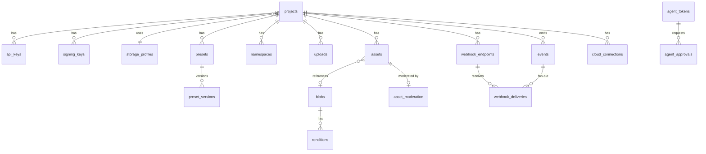

# Data Model

Full schema: [`internal/db/migrations/0001_init.sql`](../internal/db/migrations/0001_init.sql) plus [`0002_images.sql`](../internal/db/migrations/0002_images.sql) (M1: `assets.preset_id/preset_version`, `namespaces.quota_alert_level`, indexes).

## Diagram



Later migrations: `0005_files.sql` (documents), `0006_agents.sql` (`agent_tokens`, `agent_approvals`, `asset_moderation`; see [AGENTS.md](AGENTS.md)), `0007_audit_agent_actor.sql` (`audit_log.actor_type = 'agent'`), `0008_rendition_encoder.sql` (`renditions.encoder`).

## Key decisions

| Decision | Why |
|---|---|
| **Asset / Blob / Rendition** | An Asset is the product's logical entity (with metadata and namespace). A Blob is the physical processing result, shared by duplicates. A Rendition is a concrete file in R2. This enables dedup, refcount GC and reprocessing without changing the asset ID. |
| **Unique `(project, visibility, preset, version, sha256)` on blobs** | The dedup boundary: different projects never share files (isolation), and private never becomes public through dedup. |
| **Immutable `preset_versions`** | Reproducibility; changing a preset never breaks existing URLs. |
| **`reserved_bytes`** | Quota is reserved when the ticket is created (from `declared_bytes`) and settled after processing — concurrent uploads cannot exceed the limit. |
| **Outbox (`events` + `webhook_deliveries`)** | The event is written in the same transaction as the state change — no lost or "phantom" webhooks. |
| **`jobs` with `lease_until`** | A crashed worker never loses a job: an expired lease puts it back in the queue. |
| **Secrets only as `*_enc`** | AES-256-GCM, envelope encryption with the master key (see SECURITY.md). |
| **API keys as hashes** | The database holds no usable API secret. Agent tokens likewise; held agent requests and their results are AES-GCM envelopes (they may contain credentials or issued keys). |
| **Unix milliseconds, ULIDs** | Time-sortable, no timezone issues; prefixed ULIDs are readable in logs. |

## R2 object keys

```
kadr-private/tmp/{project}/{upload_id}                 # sources, 1-day lifecycle
kadr-private/{project}/{blob_id}/{name}.{format}       # private renditions
kadr-private/originals/{project}/{blob_id}.{ext}       # if retainOriginal
kadr-public/{project}/{blob_id}/{name}.{format}        # public renditions
kadr-system/litestream/kadr.db/…                       # database replica
```

`blob_id` is a ULID (80 bits of randomness), so public URLs cannot be enumerated. The namespace is not part of the key: this lets Blobs be shared between assets, and namespace deletion is done through the database (`purge_namespace` → refcount → GC).

## Working with SQLite

- One writer connection (writes serialized in the application, no `SQLITE_BUSY`) + a reader pool of `NumCPU`.
- Short transactions; no network calls (R2, webhooks) inside a transaction.
- Queries live in one place per aggregate, ready for `sqlc`; the `Store` interface hides the dialect to keep the Postgres path open (S3 in the ROADMAP).
- Nightly `PRAGMA optimize` and `wal_checkpoint(TRUNCATE)`; `VACUUM INTO` for snapshots.
- Retention: `events` 30 days, `webhook_deliveries` 30 days, `jobs` (succeeded/cancelled) 7 days, `jobs` (dead) 30 days, `idempotency_keys` 24 h, `audit_log` 1 year.
