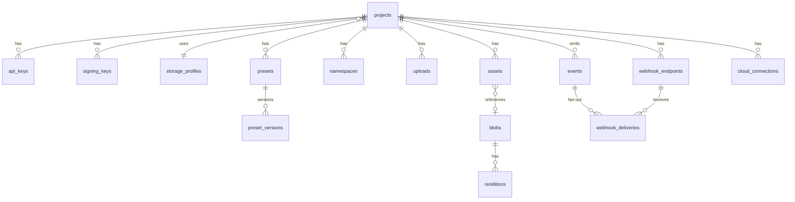

# Модель даних

Повна схема: [`internal/db/migrations/0001_init.sql`](../internal/db/migrations/0001_init.sql).

## Діаграма



## Ключові рішення

| Рішення | Чому |
|---|---|
| **Asset / Blob / Rendition** | Asset — логічна сутність проєкту (з метаданими й namespace). Blob — фізичний результат обробки, спільний для дублікатів. Rendition — конкретний файл у R2. Так працюють дедуплікація, refcount-GC і переобробка без зміни ID асета. |
| **Unique `(project, visibility, preset, version, sha256)` на blobs** | Межа дедуплікації: різні проєкти ніколи не ділять файли (ізоляція), приватне не стає публічним через дедуп. |
| **Незмінні `preset_versions`** | Відтворюваність; зміна пресету не ламає існуючі URL. |
| **`reserved_bytes`** | Квота резервується при створенні тікета (за `declared_bytes`) і розраховується за фактом після обробки — не можна перевищити ліміт паралельними завантаженнями. |
| **Outbox (`events` + `webhook_deliveries`)** | Подія пишеться в тій самій транзакції, що й зміна стану — жодних втрачених або «фантомних» вебхуків. |
| **`jobs` з `lease_until`** | Падіння воркера не губить задачу: прострочений lease повертає її в чергу. |
| **Секрети тільки `*_enc`** | AES-256-GCM, envelope-шифрування майстер-ключем (див. SECURITY.md). |
| **Ключі API як хеш** | У БД немає жодного робочого секрету API. |
| **Unix-мілісекунди, ULID** | Сортування за часом, без проблем із часовими поясами; ULID з префіксом читається в логах. |

## Ключі обʼєктів у R2

```
kadr-private/tmp/{project}/{upload_id}                 # сирці, lifecycle 1 день
kadr-private/{project}/{blob_id}/{name}.{format}       # приватні рендиції
kadr-private/originals/{project}/{blob_id}.{ext}       # якщо retainOriginal
kadr-public/{project}/{blob_id}/{name}.{format}        # публічні рендиції
kadr-system/litestream/kadr.db/…                       # репліка БД
```

`blob_id` — ULID (80 біт випадковості), тож публічні URL неможливо перебрати. Namespace у ключ не входить: це дозволяє ділити Blob між асетами, а видалення простору імен виконується через БД (`purge_namespace` → refcount → GC).

## Робота з SQLite

- Одне зʼєднання для запису (серіалізація записів у застосунку, без `SQLITE_BUSY`) + пул читачів `NumCPU`.
- Короткі транзакції; жодних мережевих викликів (R2, вебхуки) всередині транзакції.
- `sqlc` генерує типізовані запити; `Store`-інтерфейс приховує діалект, щоб мати шлях на Postgres (S3 у ROADMAP).
- Щонічний `PRAGMA optimize` і `wal_checkpoint(TRUNCATE)`; `VACUUM INTO` для знімків.
- Ретеншн: `events` 30 днів, `webhook_deliveries` 30 днів, `jobs` (succeeded) 7 днів, `idempotency_keys` 24 год, `audit_log` 1 рік.
