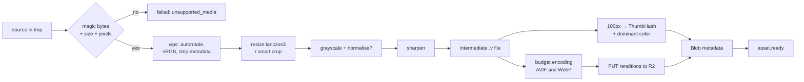
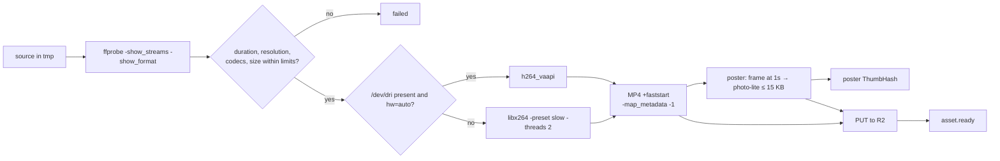

# Processing Pipelines

## 1. Presets

A preset is a named set of processing parameters at the project level. Every change creates a new **immutable version** (`preset_versions`). An asset remembers the version it was processed with, so results are always reproducible and old URLs never break.

### Default presets (created for every new project)

| slug | Kind | Purpose | Key parameters |
|---|---|---|---|
| `photo-lite` | image | Cards, inventory, thumbnails | max side 800, **≤ 20,480 B**, AVIF+WebP, light sharpen |
| `photo-balanced` | image | Full-screen viewing | max side 1440, SSIM target, AVIF q≈52 + WebP |
| `doc-lite` | image | Receipts, contracts, labels | grayscale + normalise, max side 1100, **≤ 20,480 B**, sharpen 0.85 |
| `avatar` | image | Avatars | smart crop 1:1 (attention), 256 px, ≤ 8 KB |
| `video-720p` | video | Regular clips | H.264 CRF 26, maxrate 900k, 30 fps, AAC 64k mono, poster ≤ 15 KB |
| `video-480p-eco` | video | Economy | H.264 CRF 28, maxrate 500k, 854 px |

### Parameter schema (`params_json`)

```jsonc
// image
{
  "kind": "image",
  "resize": { "maxWidth": 800, "maxHeight": 800, "fit": "inside", "crop": null /* "attention" | "centre" */, "aspect": null },
  "color": { "grayscale": false, "normalise": false },
  "sharpen": { "sigma": 0.6, "m1": 0.5, "m2": 1.5 },   // null = disabled
  "outputs": [
    { "name": "main", "format": "avif", "effort": 4, "chroma": "4:2:0" },
    { "name": "main", "format": "webp", "smartSubsample": true }
  ],
  "quality": { "mode": "budget", "maxBytes": 20480, "qMax": 60, "qMin": 30, "downscaleStep": 0.85, "minSide": 320 },
  // or { "mode": "fixed", "q": 52 } | { "mode": "ssim", "target": 0.985 }
  "placeholder": { "thumbhash": true, "dominantColor": true },
  "limits": { "maxInputBytes": 26214400, "maxInputPixels": 40000000, "accept": ["jpeg","png","webp","heic","avif","gif"] },
  "retainOriginal": false
}

// video
{
  "kind": "video",
  "video": { "codec": "h264", "maxWidth": 1280, "fps": 30, "crf": 26, "maxrate": "900k", "bufsize": "1800k", "preset": "slow", "hw": "auto" },
  "audio": { "codec": "aac", "bitrate": "64k", "channels": 1, "sampleRate": 44100 },
  "container": { "format": "mp4", "faststart": true },
  "poster": { "atSec": 1.0, "preset": "photo-lite", "maxBytes": 15360 },
  "limits": { "maxInputBytes": 2147483648, "maxDurationSec": 300, "maxWidth": 4096, "maxHeight": 4096 },
  "retainOriginal": false
}
```

## 2. Photos



**Why an intermediate `.v`:** decoding and resizing (the expensive part) happen once; encoding at different qualities works on an already small raster and takes tens of milliseconds.

### Budget encoding algorithm

```
side := min(maxSide, original long side)
loop:
  lo, hi := qMin, qMax
  best := nil
  while lo <= hi:                      # binary search, ≤ 5 iterations
    q := (lo + hi) / 2
    out := encode(raster(side), q)
    if len(out) <= maxBytes: best = out; lo = q + 1
    else: hi = q - 1
  if best != nil: return best          # highest quality that fits the budget
  if side*downscaleStep < minSide: return encode(raster(minSide), qMin)  # guaranteed result, over_budget flag
  side = side * downscaleStep          # drop pixels rather than crush quality
```

Principle: **fewer pixels at decent quality beat many pixels of mush.**

### Why the libvips CLI and not imgproxy

See [ADR-0007](adr/0007-libvips-cli-image-engine.md). In short: 0 MB RAM at idle, the full set of operations (grayscale, normalise, smart crop), no Pro-license questions, no CGO. imgproxy remains an option for future on-demand renditions.

## 3. Video



### Command (software, libx264)

```bash
nice -n 10 ionice -c3 ffmpeg -hide_banner -nostdin -y -i in \
  -map 0:v:0 -map 0:a:0? -map_metadata -1 -sn -dn \
  -vf "scale='min(1280,iw)':-2:flags=lanczos,fps=30" \
  -c:v libx264 -profile:v high -level 4.1 -pix_fmt yuv420p \
  -crf 26 -preset slow -maxrate 900k -bufsize 1800k \
  -c:a aac -b:a 64k -ac 1 -ar 44100 \
  -movflags +faststart -threads 2 \
  -progress pipe:1 out.mp4
```

### Command (VAAPI, Intel iGPU)

```bash
ffmpeg -hide_banner -nostdin -y -vaapi_device /dev/dri/renderD128 -i in \
  -map 0:v:0 -map 0:a:0? -map_metadata -1 \
  -vf "fps=30,format=nv12,hwupload,scale_vaapi=w='min(1280,iw)':h=-2" \
  -c:v h264_vaapi -rc_mode QVBR -global_quality 26 -maxrate 900k -bufsize 1800k \
  -c:a aac -b:a 64k -ac 1 -ar 44100 -movflags +faststart -progress pipe:1 out.mp4
```

At startup Kadr detects available encoders (`ffmpeg -encoders`, a 1-frame VAAPI test encode) and shows them in the admin console under System → Capabilities.

### Progress

`-progress pipe:1` → parse `out_time_us` → `jobs.progress` (0–100) → admin (SSE). Products receive only final events (`asset.ready` / `asset.failed`).

### Later (M5)

- HLS ladder 360/480/720/1080 for videos > 60 s, fMP4 segments.
- Timeline sprites (VTT) and a 3-second silent preview.
- AV1 (SVT-AV1) as an extra rendition for long-form content.

## 4. Quality assurance

- **Reference fixture set** (`test/fixtures`): photos, screenshots, documents, night shots, iPhone HEIC, rotated and VFR video.
- **Golden tests in CI:** for every preset we assert `bytes ≤ maxBytes`, a minimum SSIM against a downscaled reference, and stable dimensions.
- **Savings metric:** `original_bytes` vs `sum(rendition bytes)` per Blob → "ingested / stored / saved" dashboard.
