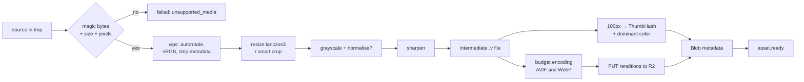
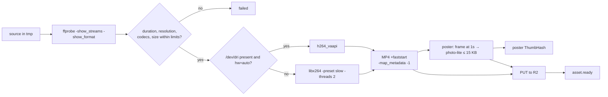

# Processing Pipelines

## 1. Presets

A preset is a named set of processing parameters at the project level. Every change creates a new **immutable version** (`preset_versions`). An asset remembers the version it was processed with, so results are always reproducible and old URLs never break.

### Default presets (created for every new project)

| slug | Kind | Purpose | Key parameters |
|---|---|---|---|
| `photo-lite` | image | Cards, inventory, thumbnails | max side 800, **≤ 20,480 B**, AVIF+WebP, light sharpen |
| `photo-balanced` | image | Full-screen viewing | max side 1440, SSIM target, AVIF q≈52 + WebP |
| `doc-lite` | image | Receipts, contracts, labels | grayscale + normalise, max side 1100, **≤ 20,480 B**, sharpen 0.85 |
| `avatar` | image | Avatars | smart crop 1:1 (attention), 256 px, ≤ 8 KB |
| `video-720p` | video | Regular clips | H.264 CRF 26, maxrate 900k, 30 fps, AAC 64k mono, poster ≤ 15 KB |
| `video-480p-eco` | video | Economy | H.264 CRF 28, maxrate 500k, 854 px |

### Parameter schema (`params_json`)

```jsonc
// image
{
  "kind": "image",
  "resize": { "maxWidth": 800, "maxHeight": 800, "fit": "inside", "crop": null /* "attention" | "centre" */, "aspect": null },
  "color": { "grayscale": false, "normalise": false },
  "sharpen": { "sigma": 0.6, "m1": 0.5, "m2": 1.5 },   // null = disabled
  "outputs": [
    { "name": "main", "format": "avif", "effort": 4, "chroma": "4:2:0" },
    { "name": "main", "format": "webp", "smartSubsample": true }
  ],
  "quality": { "mode": "budget", "maxBytes": 20480, "qMax": 60, "qMin": 30, "downscaleStep": 0.85, "minSide": 320 },
  // or { "mode": "fixed", "q": 52 } | { "mode": "ssim", "target": 0.985 }
  "placeholder": { "thumbhash": true, "dominantColor": true },
  "limits": { "maxInputBytes": 26214400, "maxInputPixels": 40000000, "accept": ["jpeg","png","webp","heic","avif","gif"] },
  "retainOriginal": false
}

// video
{
  "kind": "video",
  "video": { "codec": "h264", "maxWidth": 1280, "fps": 30, "crf": 26, "maxrate": "900k", "bufsize": "1800k", "preset": "slow", "hw": "auto" },
  "audio": { "codec": "aac", "bitrate": "64k", "channels": 1, "sampleRate": 44100 },
  "container": { "format": "mp4", "faststart": true },
  "poster": { "atSec": 1.0, "preset": "photo-lite", "maxBytes": 15360 },
  "limits": { "maxInputBytes": 2147483648, "maxDurationSec": 300, "maxWidth": 4096, "maxHeight": 4096 },
  "retainOriginal": false
}
```

## 2. Photos



**Why two files (`main.avif` and `main.webp`) per image:** they are not duplicates but two encodings of the same rendition. AVIF is ~20–30 % smaller; WebP is the fallback for clients without AVIF (older Safari/iOS < 16, some in-app browsers, e-mail clients). Serve them with `<picture><source type="image/avif" srcset="…main.avif"></picture>`. Both are byte-budgeted, so the pair typically costs ~2× a few KB. If every client of a product supports AVIF, remove the `webp` output from the preset (preset editor → outputs) and only `main.avif` is stored; likewise a WebP-only preset is valid. Video posters follow the same rule (`poster.avif` + `poster.webp`).

**Why an intermediate `.v`:** decoding and resizing (the expensive part) happen once; encoding at different qualities works on an already small raster and takes tens of milliseconds.

### Budget encoding algorithm

```
side := min(maxSide, original long side)
loop:
  lo, hi := qMin, qMax
  best := nil
  while lo <= hi:                      # binary search, ≤ 5 iterations
    q := (lo + hi) / 2
    out := encode(raster(side), q)
    if len(out) <= maxBytes: best = out; lo = q + 1
    else: hi = q - 1
  if best != nil: return best          # highest quality that fits the budget
  if side*downscaleStep < minSide: return encode(raster(minSide), qMin)  # guaranteed result, over_budget flag
  side = side * downscaleStep          # drop pixels rather than crush quality
```

Principle: **fewer pixels at decent quality beat many pixels of mush.**

### Why the libvips CLI and not imgproxy

See [ADR-0007](adr/0007-libvips-cli-image-engine.md). In short: 0 MB RAM at idle, the full set of operations (grayscale, normalise, smart crop), no Pro-license questions, no CGO. imgproxy remains an option for future on-demand renditions.

## 2b. Compression modes

Three ready-made trade-offs for **images and videos**, seeded into every project as ordinary presets (`image-compact`, `image-balanced`, `image-quality`, `video-compact`, `video-balanced`, `video-quality`) and selectable with `"mode"` in `POST /v1/uploads`, `POST /v1/assets` and the imports. Kadr picks the image or video preset from the file type; when a request names neither `preset` nor `mode`, the project's **default mode** (`balanced` unless changed) is used.

| Mode | Idea | Image | Video |
|---|---|---|---|
| `compact` | good quality, very small | max side 1080, byte budget ≤ 30 KB, AVIF q25–55 + WebP | 480p (854 px), CRF 30, ≤ 450 kbit/s, AAC 48k mono |
| `balanced` | the golden middle (default) | max side 1440, SSIM target 0.975 within q35–65, AVIF + WebP | 720p, CRF 26, ≤ 1.2 Mbit/s, AAC 96k stereo |
| `quality` | ideal quality at the smallest size that achieves it | max side 2048, SSIM target 0.99 within q45–85, AVIF 4:4:4 + WebP | 1080p, CRF 20, ≤ 5 Mbit/s, AAC 160k stereo |

On the reference photo the three image modes produce ≈ 24 KB / 96 KB / 350 KB; the video modes on synthetic noisy 1080p ≈ 0.17 / 0.6 / 2.5 MB (tests `TestCompressionModesAreOrdered`, `TestVideoModesAreOrdered`). `quality` uses the SSIM search, so it stops at the lowest quality that still reaches the target instead of always using the maximum.

Documents (`file-compact`, `file-balanced`, `file-quality`, plus `file-original` = store as uploaded) follow the same idea for PDFs — see §4:

| Mode | PDF optimisation | Thumbnail of page 1 |
|---|---|---|
| `compact` | images re-encoded at 110 dpi / JPEG 60 (Ghostscript), linearized (qpdf) | ≤ 12 KB, max side 480 |
| `balanced` | images at 150 dpi / JPEG 75, linearized | ≤ 20 KB, max side 640 |
| `quality` | lossless: qpdf recompression + object streams + linearization, no visible change | ≤ 30 KB, max side 800 |

**Per-project settings.** Each project owns its copies: edit any mode preset in the admin console (Compression modes tab — a new preset *version*; existing assets keep the version they were processed with), change the default mode, or *Reset* a preset to the built-in values. Projects created before modes existed get the six presets on the next start. The legacy purpose-specific presets (`photo-lite`, `photo-balanced`, `doc-lite`, `avatar`, `video-720p`, `video-480p-eco`) remain.

## 3. Video



### Command (software, libx264)

```bash
nice -n 10 ionice -c3 ffmpeg -hide_banner -nostdin -y -i in \
  -map 0:v:0 -map 0:a:0? -map_metadata -1 -sn -dn \
  -vf "scale='min(1280,iw)':-2:flags=lanczos,fps=30" \
  -c:v libx264 -profile:v high -level 4.1 -pix_fmt yuv420p \
  -crf 26 -preset slow -maxrate 900k -bufsize 1800k \
  -c:a aac -b:a 64k -ac 1 -ar 44100 \
  -movflags +faststart -threads 2 \
  -progress pipe:1 out.mp4
```

### Command (VAAPI, Intel iGPU)

```bash
ffmpeg -hide_banner -nostdin -y -vaapi_device /dev/dri/renderD128 -i in \
  -map 0:v:0 -map 0:a:0? -map_metadata -1 \
  -vf "fps=30,format=nv12,hwupload,scale_vaapi=w='min(1280,iw)':h=-2" \
  -c:v h264_vaapi -rc_mode QVBR -global_quality 26 -maxrate 900k -bufsize 1800k \
  -c:a aac -b:a 64k -ac 1 -ar 44100 -movflags +faststart -progress pipe:1 out.mp4
```

At startup Kadr detects available encoders (`ffmpeg -encoders`, a 1-frame VAAPI test encode) and shows them in the admin console under System → Capabilities.

### Progress

`-progress pipe:1` → parse `out_time_us` → `jobs.progress` (0–100) → admin (SSE). Products receive only final events (`asset.ready` / `asset.failed`).

### HLS ladder (`"hls": true`)

A video preset with `"hls": true` additionally produces an adaptive package next to the MP4 (the MP4 and poster are unchanged):

- One ffmpeg run, software x264 (VAAPI is not used for the ladder), `split` + `scale` per variant, audio (AAC) in every variant.
- Ladder rungs are defined by the short side: 360 / 480 / 720 / 1080, only those not larger than the source and whose width does not exceed the preset's `video.maxWidth` (default 1280), at most 4. A source below 360 gets a single variant at its own size; nothing is upscaled.
- fMP4 (CMAF) segments of 4 s, `independent_segments`, VOD playlists. Keyframes are aligned across variants (`-g fps*4`, `-force_key_frames expr:gte(t,n_forced*4)`, `-sc_threshold 0`), so the player can switch at any segment boundary. The x264 preset is capped at `medium` (the `slow` default of the MP4 would make four variants too slow); bitrates per rung: 800k / 1400k / 2800k / 5000k maxrate on top of the preset CRF.
- Layout (flat, relative URIs): `{project}/{blob_id}/hls/master.m3u8`, `v_360p.m3u8`, `init_360p.mp4`, `seg_360p_00000.m4s`, ...
- Uploaded with `application/vnd.apple.mpegurl` (playlists), `video/mp4` (init) and `video/iso.segment` (segments) and the same Cache-Control as the other renditions of the blob.
- One rendition row is recorded: name `hls`, format `m3u8`, `storage_key` = the master playlist, `bytes` = size of the whole package (also counted in the blob's total/quota). Segments have no rows: blob GC and visibility change enumerate the `hls/` prefix with `Driver.List`, so a package can never leak objects.
- Job progress: 0-50 % MP4, 50-100 % ladder. A failing ladder fails the asset (the preset asked for it).

**Private assets.** A per-object signature cannot work for HLS (a player requests dozens of segment URLs it derives from the playlist, without the query string). For a rendition of format `m3u8`, `POST /v1/sign-urls` therefore returns a directory-scoped URL: `...master.m3u8?exp=&kid=&sig=&prefix=1`, where `sig` signs the canonical string `GETP\n/{dir}/\n{exp}\n` (distinct from the per-object `GET\n/{key}\n{exp}\n{download}` form, which is unchanged). kadr-edge authorizes any object directly inside `{dir}/` for such a request and rewrites relative URIs in playlists to carry the same `exp/kid/sig/prefix`, so unmodified players (hls.js, Safari) work. Consequences: one URL grants the whole package until `exp`; `download` is ignored; the playlist is rewritten per request and not cached at the edge; the Node SDK has no helper for the prefix form yet (use `sign-urls`).

### AV1 (`"codec": "av1"`, opt-in)

`video.codec` is `h264` (default) or `av1`. AV1 is encoded with SVT-AV1 (`libsvtav1`) in software into the same MP4 container (`main.mp4`, faststart) and is typically **30–50 % smaller than H.264 at the same visual quality**. Trade-offs, which is why it is not the default:

- Playback: Chrome, Edge, Firefox, Android 10+ and Safari 17+ **only on devices with an AV1 hardware decoder** (iPhone 15 Pro and newer, Apple M3 and newer). Older iPhones/iPads cannot play it — use AV1 only where you control the clients, or keep an H.264 preset for them.
- Encoding is slower than x264 on CPU (`video.preset` maps to SVT presets: `slow` → 6, `fast` → 8, `veryfast` → 10); VAAPI is not used.
- CRF range 14–63 (good starting points: 30 compact, 26 balanced, 22 quality); `maxrate`/`bufsize` are ignored; `hls: true` requires H.264.
- The rendition's `encoder` field reads `libsvtav1`, so the product can emit `<source type='video/mp4; codecs="av01.0.05M.08"'>`.

```json
"video": { "codec": "av1", "maxWidth": 1280, "fps": 30, "crf": 32, "preset": "slow" }
```

### Later (M5)

- Timeline sprites (VTT) and a 3-second silent preview.
- AV1 + H.264 fallback pair in one preset (two MP4 renditions) for mixed audiences.

## 4. Quality assurance

- **Reference fixture set** (`test/fixtures`): photos, screenshots, documents, night shots, iPhone HEIC, rotated and VFR video.
- **Golden tests in CI:** for every preset we assert `bytes ≤ maxBytes`, a minimum SSIM against a downscaled reference, and stable dimensions.
- **Savings metric:** `original_bytes` vs `sum(rendition bytes)` per Blob → "ingested / stored / saved" dashboard.

## 4. Documents (`kind: "file"`)

Accepted formats: **PDF, DOCX, XLSX, PPTX, ODT, ODS, ODP, RTF, TXT, CSV** (a preset's `limits.accept` narrows the list). Everything else — images, video, archives, legacy binary Office (`.doc/.xls/.ppt`), macro-enabled Office files, HTML/SVG/XML — is refused.

**Validation is by content, never by file name or declared type** (`internal/engine/file`):
- PDF: `%PDF-` header, `%%EOF` trailer, page count via Ghostscript (a PDF Ghostscript cannot parse is `corrupt`).
- DOCX/XLSX/PPTX: a valid ZIP with `[Content_Types].xml` and the matching main part; ODT/ODS/ODP: the `mimetype` entry. Zip-bomb limits (≤ 20 000 entries, ≤ 2 GiB expanded, ratio ≤ 1000×); `vbaProject.bin` ⇒ refused.
- RTF: `{\rtf` header. TXT/CSV: valid UTF-8, no NUL bytes, ≤ 1 % control characters, and **never markup** (a text file starting with `<` is refused).

**Optimisation (PDF only, best effort — it never fails an upload):**
1. Skipped, original stored, when the PDF is **digitally signed** (`/ByteRange`), **encrypted** (`/Encrypt`) or claims **PDF/A** (`pdfaid:part`) — rewriting would break the signature or the conformance.
2. `downsample`: Ghostscript `pdfwrite` (`-dSAFER`, no network, minimal environment, timeout) re-encodes colour/gray images at `imageDpi` and JPEG `jpegQuality`; `lossless`: qpdf object-stream/Flate recompression; `Linearize` adds "fast web view".
3. The result is kept only if it is a valid PDF with the **same page count** and at least `minSavingsPercent` smaller; otherwise the original is stored. The reason is logged (`signed`, `encrypted`, `pdfa`, `no_savings`, `tool_missing`, `failed`).
4. Without Ghostscript/qpdf installed (see System → capabilities) documents are validated and stored as uploaded.
5. `retainOriginal` keeps the uploaded file in the private bucket when it was rewritten.

DOCX/XLSX/PPTX/ODF are ZIP containers already; they are stored unchanged (rewriting them risks corrupting documents for a few percent).

**Thumbnail:** page 1 of the PDF is rendered by Ghostscript and compressed by the image budget search (AVIF + WebP, rendition name `thumb`, ThumbHash and dominant colour included).

**Storage and delivery:** the document is the rendition `main` with `format` = `pdf`/`docx`/…; it is stored with its real `Content-Type` and `Content-Disposition: attachment; filename="…"; filename*=UTF-8''…`, so a document is downloaded, never rendered inline from the CDN origin (add a Transform Rule with `X-Content-Type-Options: nosniff` on `cdn.<domain>`; `kadr-edge` already sets it and honours the stored disposition, or `download` per URL). Dedup by SHA-256, quotas, public/private, visibility change, signed URLs and imports work like for media. Limits: 100 MB default (`limits.maxInputBytes`, max 5 GB); files over 64 MB use multipart tickets like videos; ClamAV scanning is not built in.

